# Proposed reference: Foundry enclosure and practical lighting

Owner visual approval is pending. This is the first architecture/fixture pass, not the finished two-map vertical slice.

## Reproducible comparison

All pairs use seed 345126007, 1024×576 and FOV 72. The after render is explicitly locked to the baseline camera position AND quaternion immediately before rendering; `reference/metrics.json` records and asserts exact equality. Normal playable camera collision remains enabled outside this comparison harness. Both pages load real assets through Three.js r160/WebGL. The baseline service runs d609747; the after includes material PR #55 and single-style PR #57.

### foundry-player-day

| Before | After |
|---|---|
| 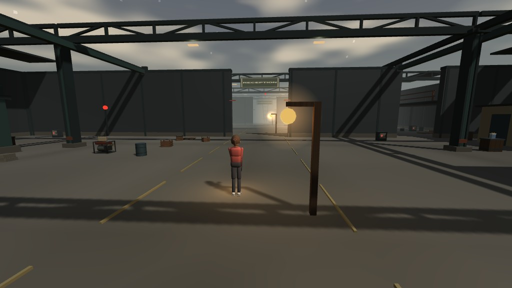 | 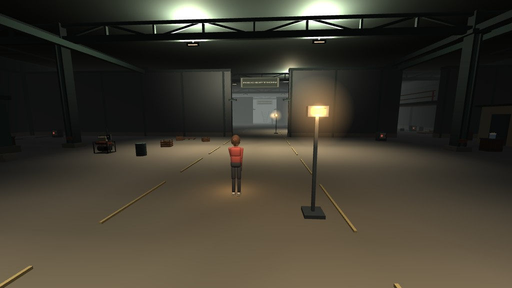 |

Draw calls 178 → 177; triangles 178638 → 179684.

### foundry-player-night

| Before | After |
|---|---|
| 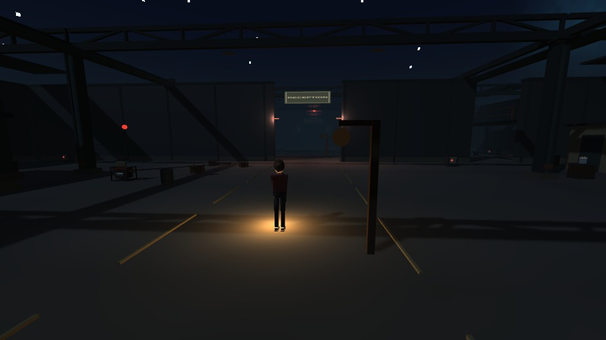 | 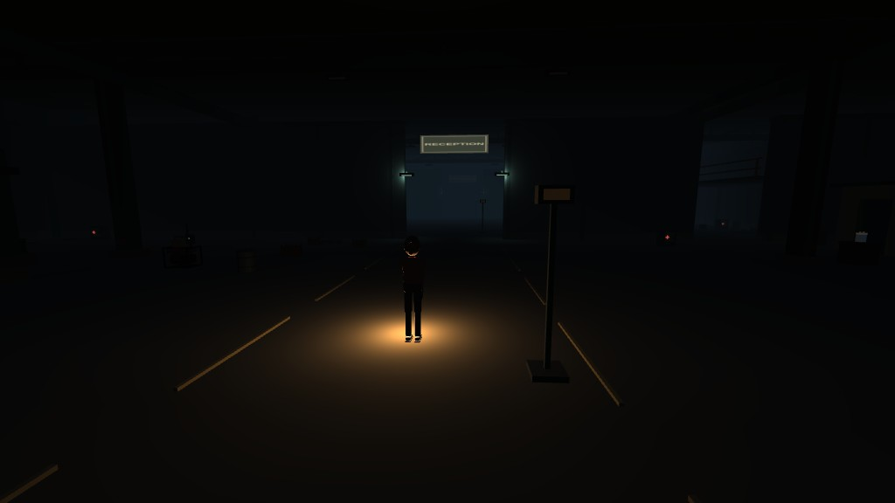 |

Draw calls 178 → 177; triangles 178638 → 179684.

### foundry-landmark-day

| Before | After |
|---|---|
| 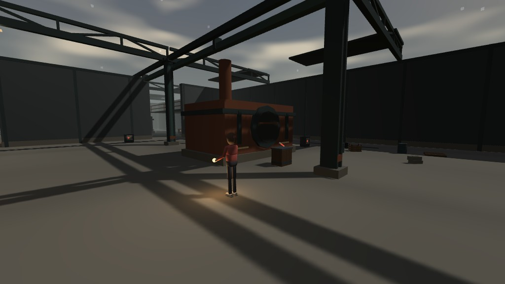 | 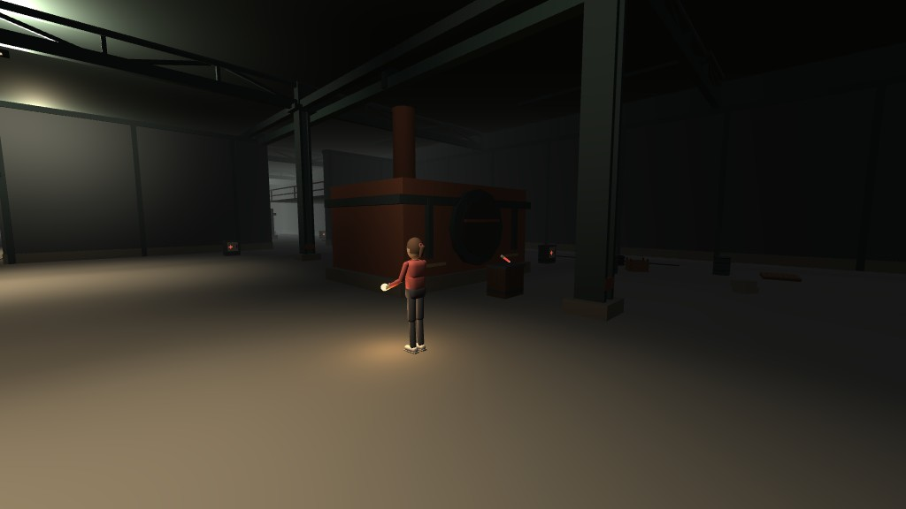 |

Draw calls 135 → 135; triangles 177636 → 178804.

### foundry-landmark-night

| Before | After |
|---|---|
| 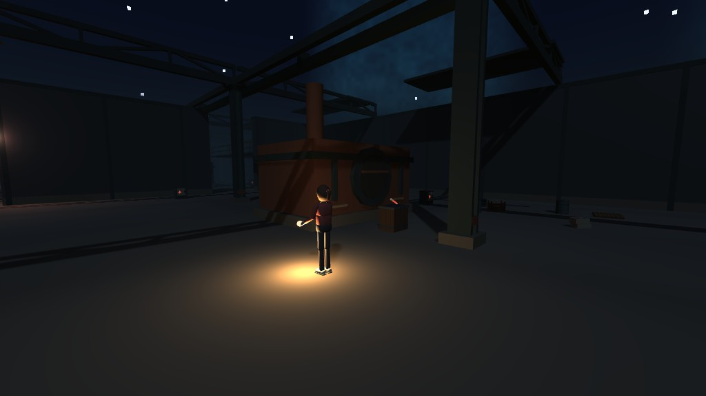 | 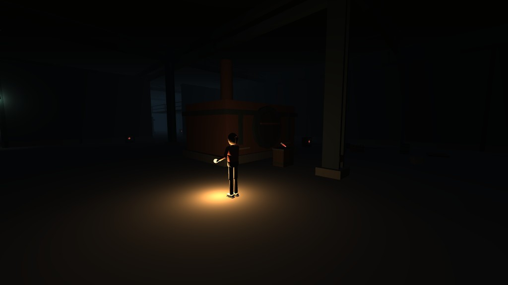 |

Draw calls 135 → 134; triangles 177636 → 178802.

### ashfall-player-day

| Before | After |
|---|---|
| 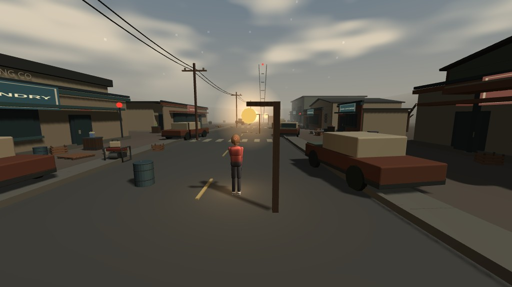 | 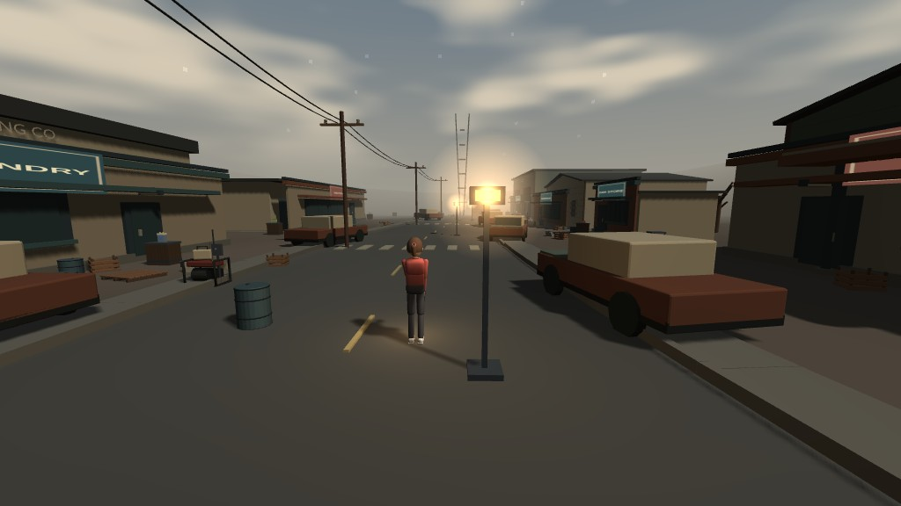 |

Draw calls 191 → 189; triangles 193448 → 193690.

### ashfall-player-night

| Before | After |
|---|---|
| 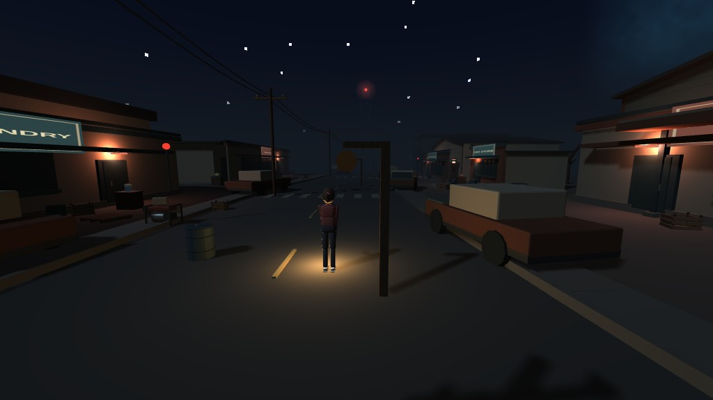 | 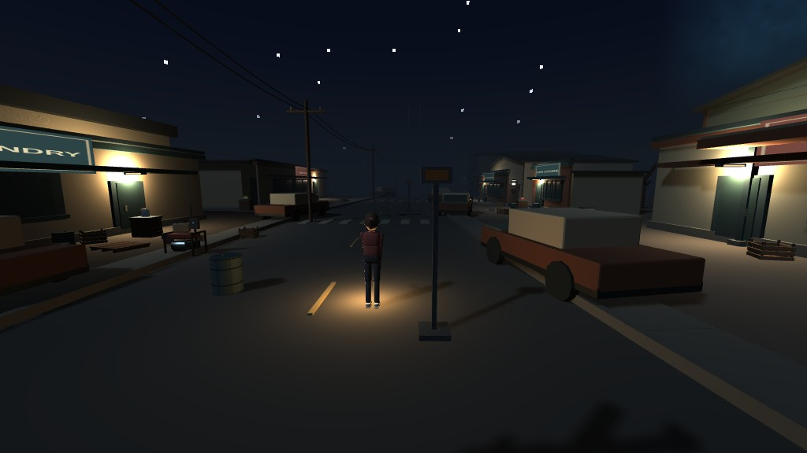 |

Draw calls 191 → 189; triangles 193448 → 193690.

## Calibration proposal

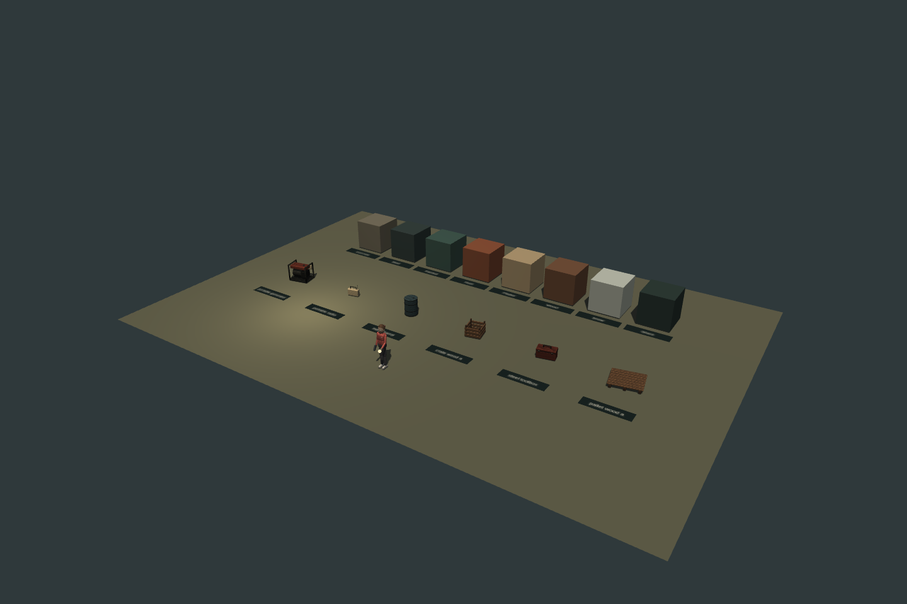

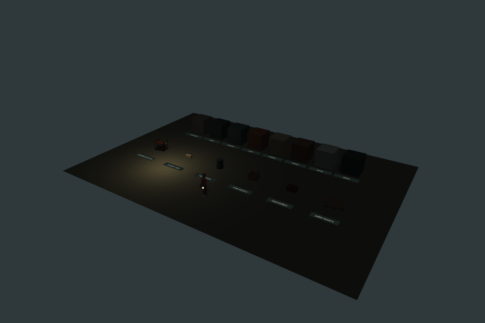

These actual renderer captures propose material/shape direction; monitor colour calibration, source scale audit and owner approval are still pending.

## Verification and boundaries

31 architecture/rules/real HTTP-WebSocket cases pass, glTF material fixture passes, and all six actual WebGL worlds load with no runtime exceptions or failed required requests. The six-world check caught an indexed/non-indexed lamp geometry mismatch, reproduced it, and then passed after normalising the lamp geometry. `tools/world-contract.test.mjs` checks the physical practical fixtures and removal of the visual selector too.

The comparison uses the same camera, not identical rendering work. One-frame CPU/heap and capped 60-FPS capture do not establish p95/p99 or long-run performance. Draw calls are recorded per image.

Gameplay budgets, phase timing and objective/extraction coordinates are unchanged. Foundry's roof now participates in camera and bullet rays while floor navigation remains clear. Ashfall receives justified fixtures, not yet the requested street/route reconstruction. Distinct authored routes, extraction approach, source scale/colour audit, all-map artistic migration and six-human balance remain open. Approximate AABB overhead collision and global indoor lighting need player review. Revert this reference commit as a unit for rollback. No production deployment or main merge.
