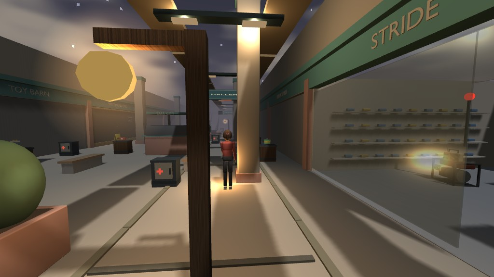
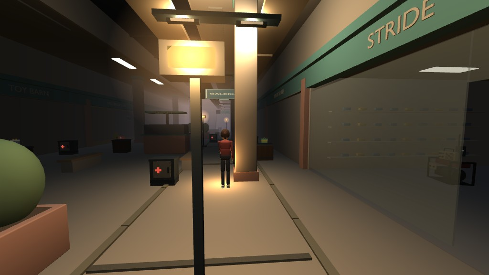
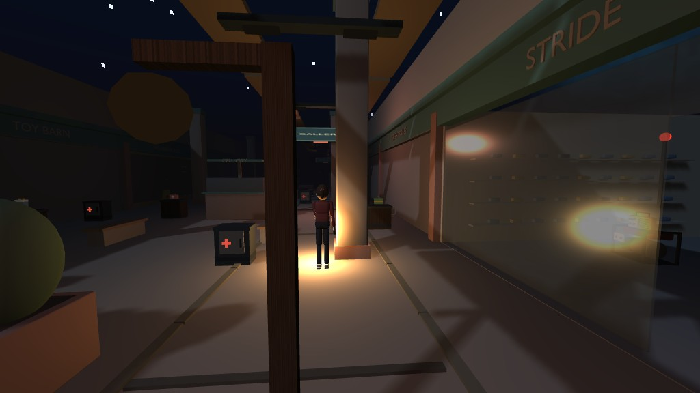
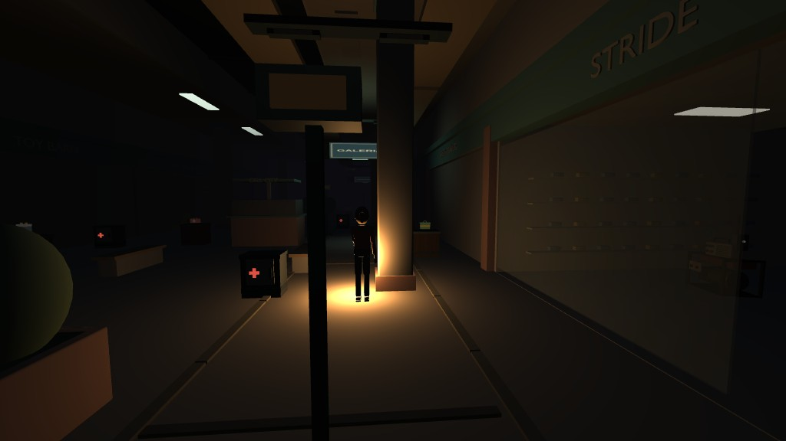
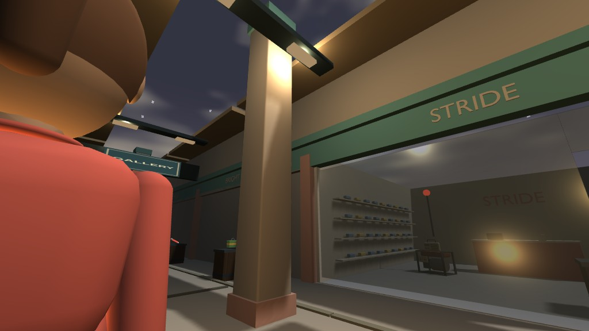
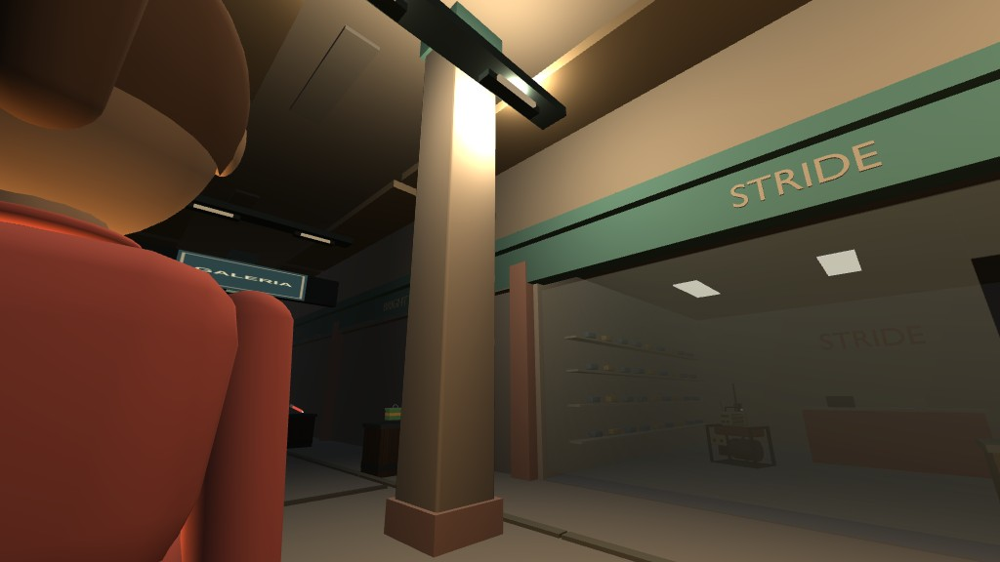
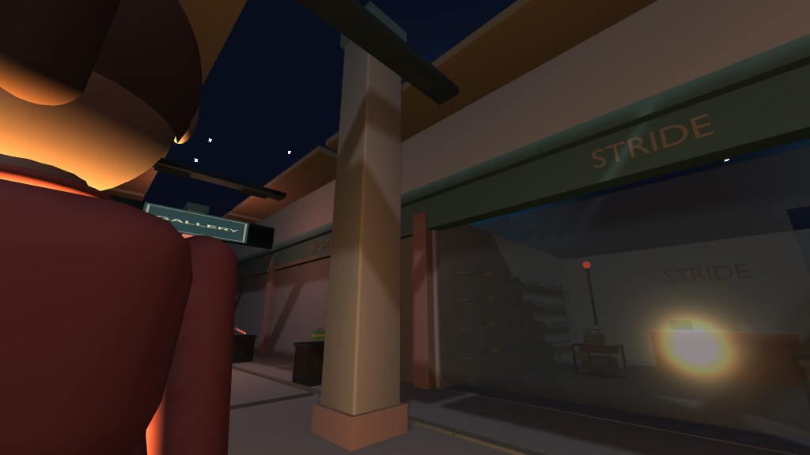
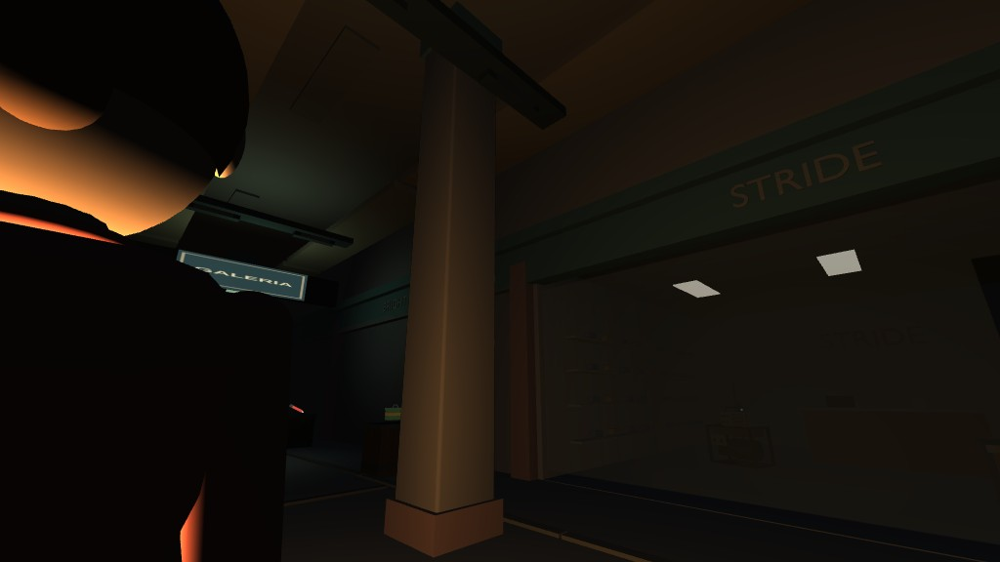

# Mall ceiling restoration

The source GLB includes `CEIL_mall` and `CEIL_service`; the runtime explicitly excluded those ancestors. This pass restores the existing model, including the ceiling/skylight/service roof and its authored fittings. No new art import or all-map art migration is implied.

`tools/mall_to_map.mjs` now derives 360 structural ceiling triangles from the same GLB, with the same centering offset as the visible model. Selected structural material names are ceiling, night_sky_glass, dark_void and wall_cream; decorative lenses, cameras and tiny fixtures are not new solid obstacles. The exporter refuses unsupported transformed ceiling nodes or accessor formats instead of emitting misleading collision. Shared camera/bullet rays use double-sided triangle intersection; ground movement/navigation remains on the existing floor collisions. A height early-out avoids triangle work for rays entirely below the lowest roof.

The actual Chrome test compared 145 ground-to-roof ray queries against Three.js raycasts on the real imported structural meshes plus existing floor/wall boxes: 145 roof hits and zero mismatches at a .002 segment-fraction tolerance. `mall-ceilings/ray-evidence.json` records this result. The focused roof regression first failed before the fix. Thirty-four architecture/rules/network/asset cases pass. All-six-world rendering still loads; CI result for this commit must be checked independently.

Mall's lower practical fixtures use power 6 rather than the tall factory work fixture's 38 (renderer units, not certified photometry). Restoring enclosure exposed excessive glare from those short-throw fixtures; lowering them preserves the authored ceiling/silhouette and readable floor.

| View | Before | After |
|---|---|---|
| Player/day |  |  |
| Player/night |  |  |
| Roof/day |  |  |
| Roof/night |  |  |

All pairs are seeded, 1024×576/FOV72 and lock after rendering to exactly the baseline camera position and quaternion; see `mall-ceilings/metrics.json`. Per-image draw/triangle counts are recorded there. Individual captured FPS can be disturbed by parallel browser work and is not a performance pass. A longer isolated runtime test remains required.

Open: corridor widening/loops, authored objective placement, scale/grounding of procedural additions, chase fairness, continuous camera sweeps and human low-light judgement. This fixes the accidental missing roof, not the whole BS-LEVEL-05 acceptance gate. No objective/resource/phase budget changes. Rollback all files in this commit together so rendering and shared ray geometry agree. No production change or main merge.
