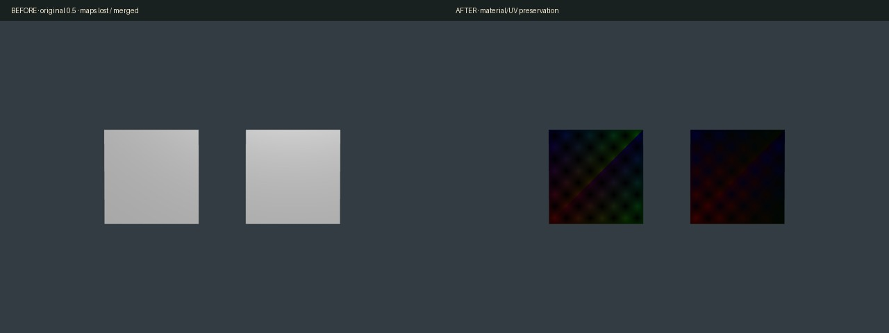

# Material pipeline regression evidence

Issue: BS-ART-02 / #7. Test command: `npm run test:models` with the local game running and Chrome debugging at CHROME_DEBUG_URL (default localhost:9533). The test drives the real r160 GLTFLoader, material conversion and buildStatic in a WebGL browser.

## Before / after

The identical glTF fixture has two materials with the same name/colour and different checker maps. Baseline drops both maps, UV, tangent and vertex colour; collapses the two materials; rejects a multi-material geometry. The fixed path retains maps (including normal/roughness/metalness/alpha), scalar values, geometry attributes and group boundaries. Six source triangles remain six triangles. These are generated QA fixtures, not newly approved environmental assets.

Root causes: cloning only selected scalar fields; deleting geometry attributes; incomplete name/colour material cache keys. Conversion now clones the original material and caches per source identity. Batching uses complete render properties/texture references and geometry attribute formats, allowing compatible materials to share without merging incompatible maps. Multi-material groups honour draw ranges.

## Executed validation

- Real glTF browser fixture: red on baseline, green after the fix, zero runtime or request errors.
- Eighteen rule and twelve network cases pass; no rule, collision or production runtime changes.
- Identical-camera Foundry, Ashfall and Mall captures by day/night and at player/landmark/chase positions.

| View | Draw calls before | After | Median frame before / after (ms) |
|---|---:|---:|---|
| ashfall-overview-day | 207 | 207 | 16.70 / 16.70 |
| foundry-overview-day | 180 | 180 | 16.70 / 16.70 |
| mall-overview-day | 230 | 226 | 16.70 / 16.70 |

Chrome desktop capture was capped around 60 FPS. These measurements do not establish 120/144 Hz support, six-human load or a thirty-minute memory/latency soak. Restoring real material distinctions may require more draw calls than the incorrect merged baseline; measure budgets before reducing quality.

Known limits: legacy painterly colour calibration and optional missing-asset swallowing are separate open issues. No environment art approval, human gameplay claim, main-branch merge or deployment is included. Rollback: revert this thematic material PR.
