# Menu flow review

The dense all-in-one menu is separated into Home, Play, Room, How to Play, Settings and Account. Persistent navigation keeps those tasks reachable. Play handles public room discovery, private invitation and public/private creation; map previews sit behind a disclosure until joining. Room opens automatically after joining and separates maps from roster/readiness/chat on desktop. On narrow screens preparation comes before the map gallery. Leaving clears membership and returns to Play. The existing visual identity and all underlying gameplay timings/resources remain unchanged.

The actual browser flow passes private invitation, public creation/list/join, host/non-host map permissions, readiness/start, plain-text chat, Esc return/leave, keyboard guide tabs, settings/account navigation, invalid invite, empty room list, EN/pt-PT and horizontal-overflow checks. See `menu-views/evidence.json`; run `npm run test:menu` against the local server and Chrome debug endpoint. All 54 server/asset contracts also pass. This browser test is included in CI, whose remote result must be observed after publishing the branch.

Captures cover 1440×900 desktop EN and 390×844 narrow-menu pt-PT. Files ending `-full.png` temporarily expand the same scrolling menu container to inspect below-fold content; other captures are unmodified first viewports. Narrow-screen tests use desktop Chrome with emulated dimensions and synthesized mouse/keyboard, not physical mobile/touch gameplay. The named QA guests/chat are synthetic.

The independent Impeccable finish reviewer returned one material fix: invitation placeholder contrast was 3.60:1. After explicitly theming it, the repeated actual browser flow and captures passed; the reviewer scored that fix resolved at 8.69:1 and returned `ship` for that scored fix. That verdict does not approve environmental art, six-human onboarding or the whole game's acceptance criteria. Remaining detector warnings were assessed as inherited font choice, short uppercase metadata, intentional gameplay damage feedback and boundary-free section alignment; no second detector was run.

| View | Desktop | Narrow menu |
|---|---|---|
| Home | 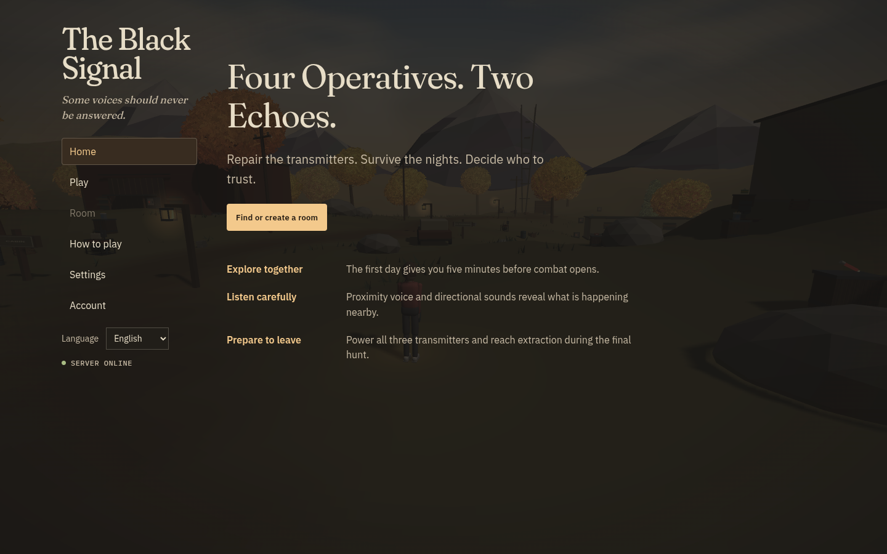 | 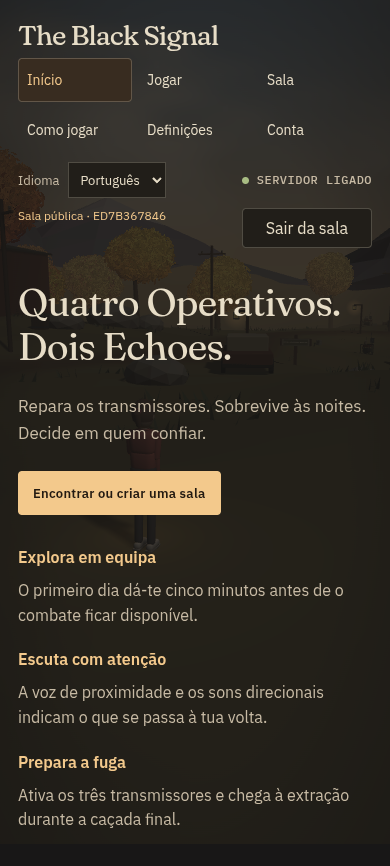 |
| Play | 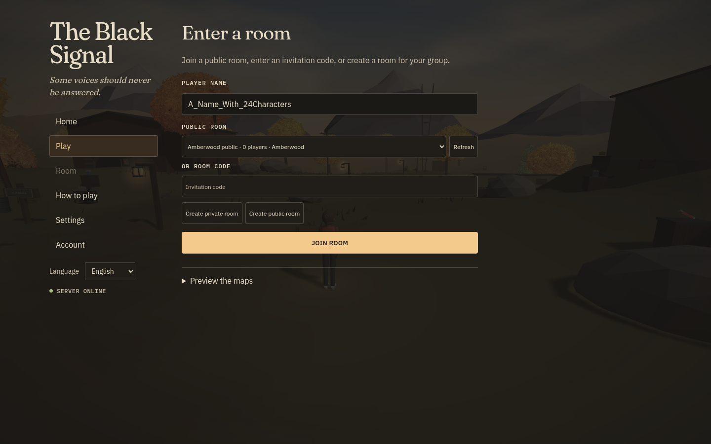 | 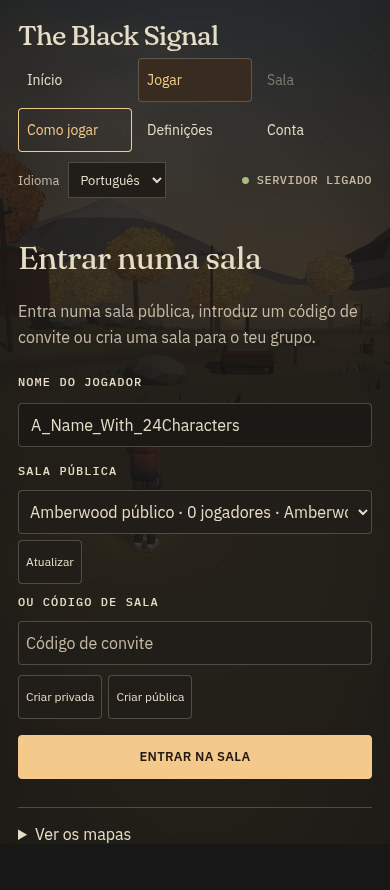 |
| Room | 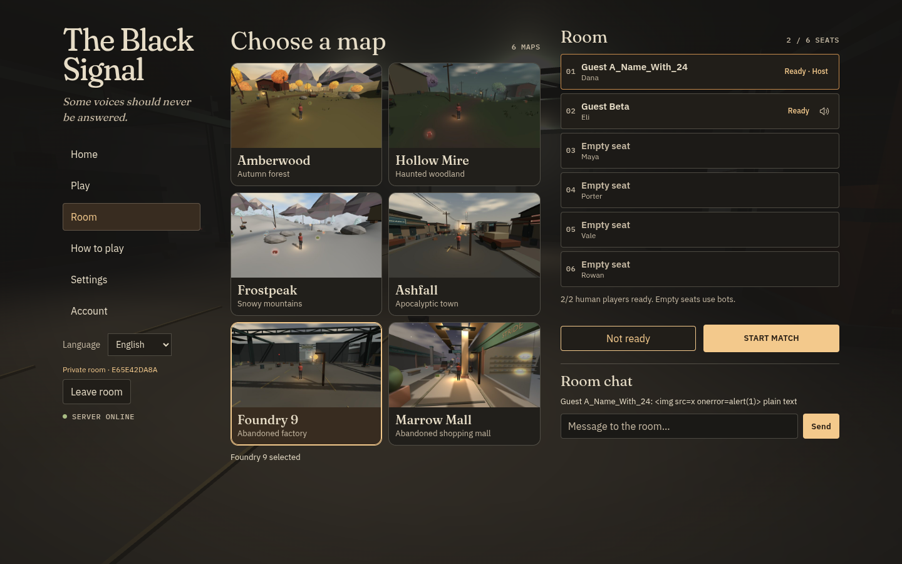 | 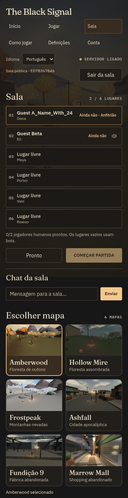 |
| Settings | 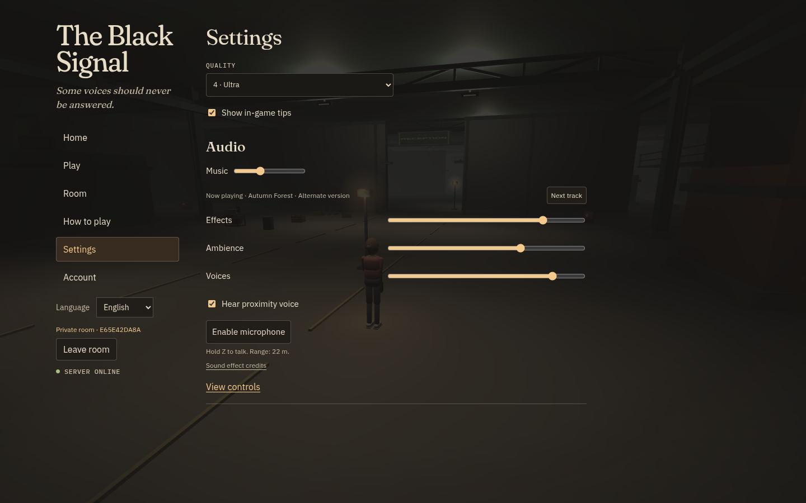 | 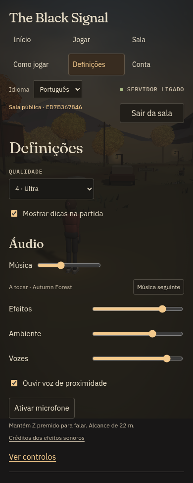 |
| Guide | 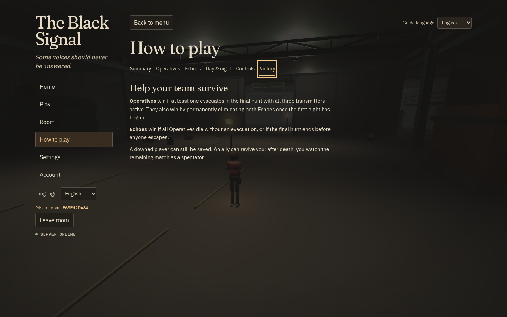 | 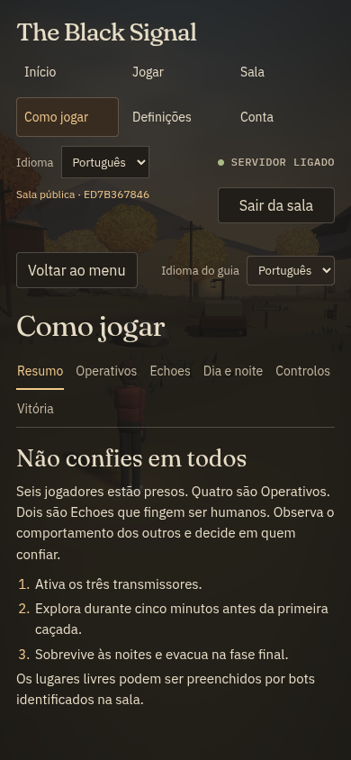 |
| Account | 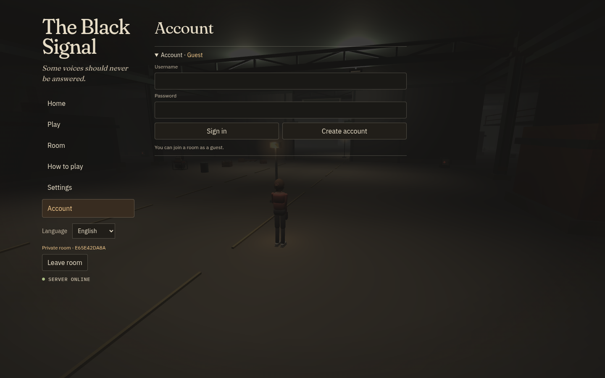 | 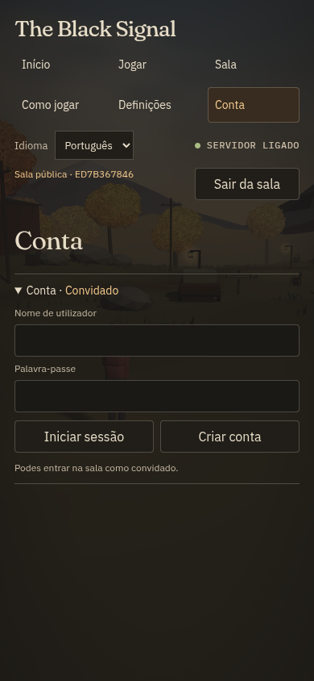 |

The before view is `readiness/room-en.png`. This refinement adds no framework/runtime dependency or external artwork. Existing map thumbnail artwork is inherited from the 0.5 review and still needs refresh after reference-level art approval. Account recovery/deletion/moderation, physical-device testing and six-person first-use testing remain open. Rollback this UI commit independently of the preceding readiness protocol. No main merge or production change.
